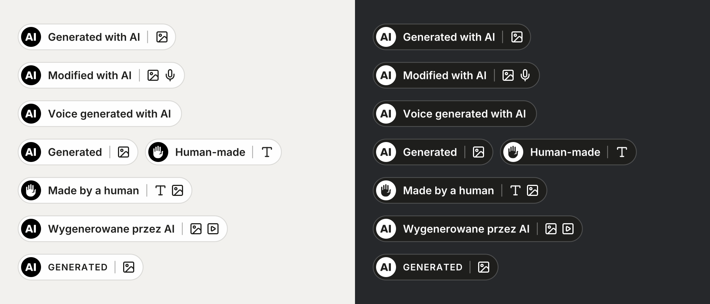
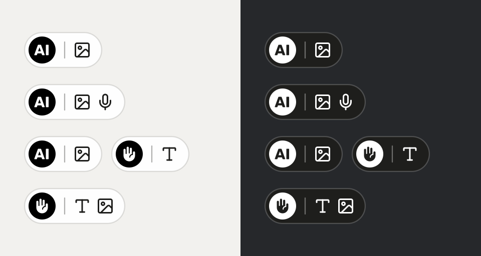
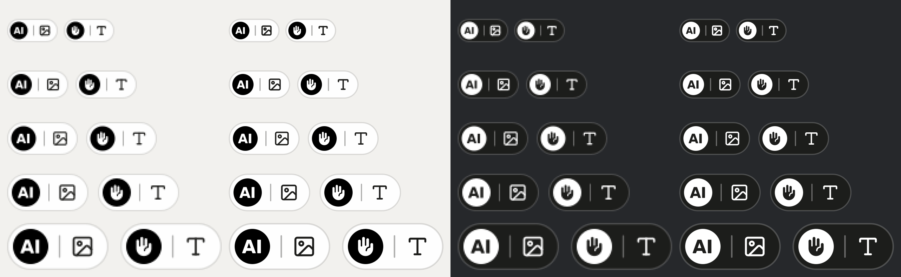

# ai-content-labels

[](https://github.com/JK-G/ai-content-labels/actions/workflows/test.yml)

Labels for AI-generated and human-made content, built on the official EU icons, for any AI agent. It fits agents that generate images best. They already know the image is AI, so one call (`ai-labels label` or the MCP tool `label_image`) tells them whether the EU AI Act requires a label and burns it into the image. ai-content-labels also draws labels that keep WCAG contrast on any background, writes them as HTML for web pages and hands you the alt text. It ships as a CLI, an MCP server (stdio and HTTP), a Node library and an Agent Skill that works in Codex, Gemini CLI, Copilot, Cursor and Claude Code.



Unofficial. Not affiliated with the European Commission, and not legal advice.

## Why

Article 50(4) of the AI Act applies from 2 August 2026. Deep fakes, and AI-generated text published to inform the public on matters of public interest, must be disclosed by the professional user of the AI system (the deployer). The deployer duty was not delayed by the AI Omnibus. On 10 June 2026 the Commission published three icons for this, free for anyone to use. In the Commission's words, "the use of these EU icons is optional, but the labelling requirements under Article 50 AI Act are not."

The icons leave the practical questions open. Does this image need a label at all? Which of the three icons? Where does it go, how big, and what does a screen reader hear? How do you show that only the voice was AI and the script was written by a person? This project answers those questions in code, so a person or an agent gets the same answer every time.

## What it does

- **`label`** is the one-call version for an image an agent has just generated or edited. You say whether people could take it for real; it runs `decide` and stamps the label `decide` picked. Voluntary labels are stamped too, unless you pass `--only-if-required`. Over MCP it is `label_image`, which also takes the image as a URL or base64 and can return the labelled image instead of writing a file.
- **`decide`** goes through the Article 50(4) questions: would the audience take the content for real, is it an artistic work, is the text published on a matter of public interest, did a person review it. It returns whether the label is a duty or a voluntary choice, which label fits (and the official EU icon with the same meaning), where to place it, the label sentence and the next step, as a command and, in JSON and over MCP, as the tool call to make. When a deciding fact is missing, it asks one question instead of guessing. The answer is a few lines; `--explain` adds the legal basis, notes and sources.
- **`stamp`** burns the label into a JPG, PNG, WebP, AVIF or TIFF, so it survives downloads and reshares as the EU guidance asks. You always say which label (`--kind`); stamp never assumes "Generated with AI". The label height follows the image (about 6% of the shorter side and at least 2.5% of the longer side, never below 28 px or above 512 px), its colour is the one that stands out more from the corner it sits in. Those are the file's pixels: for an image shown smaller, such as a post full width on a phone, pass `--display-width 390` and the label stays at least 28 px tall on that screen. For generated and modified labels an IPTC DigitalSourceType tag goes into the XMP; basic and human-made labels get only the project's marker, because the IPTC vocabulary has no term for them.
- **`render`** draws the same label as SVG, PNG or WebP, with `role="img"`, `lang` and an `aria-label`. With `--format html` it writes the label as real text and inline icons, for web pages and apps.
- **Content-type icons** show which part was AI: image, text, audio, voice, music, video. A second label, "Made by a human", shows which part was not.
- **`eu`** gives you the twelve official EU files, unchanged.
- **Languages:** English and Polish wording is built in. For the other 22 official EU languages, pass `--lang` with your own `--text` in that language (`--lang de --text "Mit KI generiert"`), so screen readers read the label with the right voice.

## Use it with your agent

Requires Node.js 20.9 or newer. Drawing SVG labels and `decide` need nothing else. Stamping and PNG output use [sharp](https://sharp.pixelplumbing.com), an optional dependency that npm installs with the package.

| Agent or tool | Way in | Setup |
|---|---|---|
| Claude Code | Plugin: skill and MCP server | [Claude Code](#claude-code) |
| Codex, Gemini CLI, GitHub Copilot in VS Code, Cursor | Agent Skill, or the MCP server | [Agent Skill](#agent-skill), [MCP server](#mcp-server) |
| Claude Desktop, Windsurf (Devin Desktop) | MCP server | [MCP server](#mcp-server) |
| OpenAI Agents SDK, Vercel AI SDK, LangChain | MCP server from code | [In code](#in-code) |
| n8n, ChatGPT apps, cloud agents | MCP server in HTTP mode | [HTTP mode](#http-mode) |
| Scripts, CI, ComfyUI | CLI | [CLI](#cli) |
| Your own Node.js code | Library | [Node library](#node-library) |

Our test suite covers the CLI, the library, the stdio MCP server and the HTTP mode on Windows, macOS and Linux. The client setups below follow each client's documentation; we have not run them in every client, so treat the ones marked untested as a starting point.

### Claude Code

```
/plugin marketplace add JK-G/ai-content-labels
/plugin install ai-content-labels@ai-content-labels
```

The plugin system does not run npm, so after a plugin install ask Claude to "run ai-content-labels doctor" and it will tell you the one command that adds sharp.

### Agent Skill

The skill folder works in any agent that reads [Agent Skills](https://agentskills.io/specification). Per the vendors' docs, Codex, Gemini CLI, Copilot in VS Code and Cursor read `~/.agents/skills/`, and Claude Code reads `~/.claude/skills/`; check your client's docs if the skill does not show up. For one project only, use `.agents/skills/` inside it.

```
git clone https://github.com/JK-G/ai-content-labels
mkdir -p ~/.agents/skills
cp -r ai-content-labels/skills/ai-content-labels ~/.agents/skills/
cd ~/.agents/skills/ai-content-labels && npm install sharp@0.35
```

On Windows PowerShell, copy with `Copy-Item -Recurse ai-content-labels\skills\ai-content-labels $HOME\.agents\skills\`. The last step adds sharp to the copied skill; skip it if you only need SVG labels and `decide`. The folder carries its own licence notices (`NOTICE.md`), so copy it whole.

### MCP server

Every client starts the same command: `npx -y -p github:JK-G/ai-content-labels ai-content-labels-mcp`. The first start downloads the package and sharp, which can take a minute. On Windows some clients need `"command": "cmd"` with `"/c", "npx"` at the start of the arguments.

Codex (untested), in `~/.codex/config.toml`:

```toml
[mcp_servers.ai-content-labels]
command = "npx"
args = ["-y", "-p", "github:JK-G/ai-content-labels", "ai-content-labels-mcp"]
startup_timeout_sec = 60
```

or `codex mcp add ai-content-labels -- npx -y -p github:JK-G/ai-content-labels ai-content-labels-mcp`.

Gemini CLI (`~/.gemini/settings.json`), Claude Desktop (`claude_desktop_config.json`) and Windsurf (`mcp_config.json`), untested:

```json
{
  "mcpServers": {
    "ai-content-labels": {
      "command": "npx",
      "args": ["-y", "-p", "github:JK-G/ai-content-labels", "ai-content-labels-mcp"]
    }
  }
}
```

Cursor (`.cursor/mcp.json`) takes the same block with `"type": "stdio"` added. VS Code (`.vscode/mcp.json`) names the top key `servers` (untested):

```json
{
  "servers": {
    "ai-content-labels": {
      "type": "stdio",
      "command": "npx",
      "args": ["-y", "-p", "github:JK-G/ai-content-labels", "ai-content-labels-mcp"]
    }
  }
}
```

The tools are `label_image`, `decide_label`, `render_label`, `stamp_image` and `eu_icon`. Each has an output schema and returns structured content next to the same JSON as text. The server speaks MCP 2024-11-05 to 2025-11-25 (clients that start with `initialize`) and 2026-07-28 (`server/discover` and per-request metadata).

### In code

These pass the same command to the framework's MCP client. All untested.

OpenAI Agents SDK (Python):

```python
from agents.mcp import MCPServerStdio

labels = MCPServerStdio(params={"command": "npx", "args": ["-y", "-p", "github:JK-G/ai-content-labels", "ai-content-labels-mcp"]})
```

Vercel AI SDK, with the stdio transport from the MCP TypeScript SDK (`@modelcontextprotocol/sdk`):

```js
import { createMCPClient } from '@ai-sdk/mcp';
import { StdioClientTransport } from '@modelcontextprotocol/sdk/client/stdio.js';

const labels = await createMCPClient({
  transport: new StdioClientTransport({ command: 'npx', args: ['-y', '-p', 'github:JK-G/ai-content-labels', 'ai-content-labels-mcp'] }),
});
```

LangChain (`langchain-mcp-adapters`):

```python
from langchain_mcp_adapters.client import MultiServerMCPClient

client = MultiServerMCPClient({"labels": {"command": "npx", "args": ["-y", "-p", "github:JK-G/ai-content-labels", "ai-content-labels-mcp"], "transport": "stdio"}})
```

The Agents SDK can also reach the server in HTTP mode with `MCPServerStreamableHttp`.

### HTTP mode

For clients that cannot start a local process:

```
npx -y -p github:JK-G/ai-content-labels ai-content-labels-mcp --http
```

It serves Streamable HTTP on `http://127.0.0.1:8787/mcp` with JSON responses. The defaults are the safe ones:

- It listens on 127.0.0.1 only. `--host 0.0.0.0` (or any other address) also needs `--token <secret>` (or `AI_CONTENT_LABELS_TOKEN`), and every request must then send `Authorization: Bearer <secret>`.
- File paths are off. Images come in as an https URL or base64 and go back as image content in the result. `--allow-files` turns paths on when the server runs on your own machine.
- Plain http URLs, and URLs that point at loopback or private addresses, are refused, so the server cannot be used to read your network. (The CLI, the stdio server and the library also fetch http URLs.)
- At most 3 tool calls run at once; more get 503 with `Retry-After`. Images over 50 megapixels, and SVG input, are refused before they are decoded.
- Browser requests need `--allow-origin <origin>`; any other Origin header gets 403.

The built-in n8n MCP Client node speaks HTTP only, so point it at the `/mcp` address with the bearer token. ChatGPT apps and connectors need a public HTTPS address: run HTTP mode behind a TLS proxy with a token. We have not tested either.

### CLI

```
npx -y -p github:JK-G/ai-content-labels ai-labels label image.png --realistic --description "what it shows"
```

Installed with npm (`npm install -g github:JK-G/ai-content-labels`), the command is `ai-labels`, also available as `ai-content-labels`. From a clone, run `node skills/ai-content-labels/scripts/ai-labels.mjs`.

### Node library

```js
import { labelImage } from 'ai-content-labels';

const result = await labelImage(imageBuffer, { realistic: true, description: 'What the image shows' });
// result.buffer: the labelled image; result.alt: the alt text to publish; result.required: a legal duty or not
```

`labelImage` also takes a file path or an http(s) URL. The package exports `decide`, `renderLabel`, `renderHtml`, `stampImage`, `stampBuffer` and `officialIcon` as well.

## After your agent generates an image

Run `ai-labels init --write` once in a project. It adds a short block to `AGENTS.md`, or to the file you name with `--file`, such as `GEMINI.md`. The block tells the agent to label every image it makes for publication, to answer the realism question honestly and to publish the alt text. Running it again updates the block in place.

Where the common image tools put their files, and the step after each:

- **Codex.** Per Codex's imagegen skill, built-in image generation saves to `$CODEX_HOME/generated_images/<session>/`; check the Codex docs for your version. Copy the image into the workspace, then run `ai-labels label <file> --realistic` or `--no-realistic`. Untested.
- **Gemini CLI with the nanobanana extension.** Images land in `./nanobanana-output/`; run `ai-labels label nanobanana-output/<file>` with the realism answer. Untested.
- **OpenAI Agents SDK.** The image generation tool returns base64. Pass it to `label_image` as `input_base64` and take the labelled image from the image content of the result, or save it and run the CLI. Untested.
- **ComfyUI.** Images go to `ComfyUI/output`. Add a step after the queue finishes that runs `ai-labels label` on the new file. Untested.
- **n8n.** Use HTTP mode with the MCP Client node, or an Execute Command node that writes the binary to disk and runs `ai-labels label`. Untested.
- **C2PA.** Stamping changes the pixels, so stamp first and sign after. Run `ai-labels label` with `--out`. Then, in the manifest you sign the labelled file with using `c2patool`, add a `c2pa.created` action whose `digitalSourceType` is `http://cv.iptc.org/newscodes/digitalsourcetype/trainedAlgorithmicMedia` (generated) or `compositeWithTrainedAlgorithmicMedia` (modified). c2patool writes only what your manifest contains. A manifest signed before the stamp no longer verifies. Untested.

## Quick start

Ask your agent in your own words: "label this image as AI-generated", "does this AI photo need a label under the AI Act?", or in Polish "oznacz tę grafikę jako wygenerowaną przez AI". The skill works out the facts, runs `decide`, stamps or renders the label and gives you the alt text to publish.

From the command line. `ai-labels` is the command the package installs; from a clone, run `node skills/ai-content-labels/scripts/ai-labels.mjs` instead.

For an image an agent just made, `label` decides and stamps in one step:

```
$ ai-labels label portrait.png --realistic --description "Portrait of a woman in a linen shirt, studio light"
REQUIRED: realistic AI image, a deep fake under Article 50(4)
portrait.ai-label.png
label: 363×61 px, dark pill, top-left, text contrast 12.55:1, stands out 7.18:1 from the image
display: 24 px tall or more when the image is shown 403 px wide or wider; shown narrower, as on a phone, it is smaller: pass --display-width 390
disclosure: Generated with AI: image.
alt: Portrait of a woman in a linen shirt, studio light. Generated with AI: image.
metadata: XMP DigitalSourceType trainedAlgorithmicMedia
```

`--modified` is for a real photo that AI changed. With `--no-realistic` the label is voluntary and `label` still stamps it; `--only-if-required` skips it. Without either answer it asks the question below and exits with code 2.

For anything else, start with `decide`:

```
$ ai-labels decide --media image --origin generated
UNKNOWN: Would the people who will see it take it for a genuine photo, recording or event? Rerun with --realistic or --no-realistic.

$ ai-labels decide --media image --origin generated --realistic
REQUIRED: realistic AI image, a deep fake under Article 50(4)
Next: ai-labels stamp <image> --kind generated --media image --description "what it shows"
Label: --kind generated --media image, says "Generated with AI: image." (official EU icon with this meaning: generated)
- Burn the label into the image pixels (the `stamp` command), so it stays visible when the image is downloaded or reshared.
- Use a corner where platforms do not draw their own buttons or captions; ...
Accessibility: Give the image an alt text that says what it shows, then the label sentence (alt="<what the image shows>. Generated with AI: image."); ...
Do not animate the label (WCAG 2.2.2) or make it flash (WCAG 2.3.1). Not legal advice. More: rerun with --explain

$ ai-labels stamp wolf.png --kind generated --media image --description "Low-poly grey wolf standing, front view"
wolf.ai-label.png
label: 447×75 px, light pill, top-left, text contrast 14.78:1, stands out 14.19:1 from the image
display: 24 px tall or more when the image is shown 402 px wide or wider; shown narrower, as on a phone, it is smaller: pass --display-width 390
disclosure: Generated with AI: image.
alt: Low-poly grey wolf standing, front view. Generated with AI: image.
metadata: XMP DigitalSourceType trainedAlgorithmicMedia

$ ai-labels render --kind modified --media image,voice --human text --lang pl --out label.svg
$ ai-labels render --format html --kind generated --media text
```

`decide` exits with code 2 when it has to ask, so a script cannot mistake a question for a verdict. For text published on a matter of public interest it also asks whether a person reviewed it (`--editorial-review`), because that decides the case. With `--json`, the field `missing` names the argument to answer, and after a verdict the field `next` holds the next call: the MCP tool, the arguments to pass unchanged, the ones still to fill in (`fill`) and the CLI line. `ai-labels help` lists every option.

## Which label

| Kind | Use it when | Default text (en / pl) |
|---|---|---|
| `generated` | All of the content comes from AI, apart from the prompt | Generated with AI / Wygenerowane przez AI |
| `modified` | Real or human-made content was partly changed by AI: a swapped face, added objects, a replaced voice | Modified with AI / Zmodyfikowane przez AI |
| `basic` | AI was involved and you want your own words, such as "Voice generated with AI" | Made with AI / Z udziałem AI |
| `human` | A person made it without generative AI, and you want to say so | Made by a human / Stworzone przez człowieka (this project's own mark, not an EU icon) |

`--media` adds the content-type icons. `--human text` puts a "Made by a human" label next to an AI label. `--short` switches to the compact wording that mirrors the EU icons ("Generated"), and `--uppercase` sets it in spaced capitals like the icons themselves.

### Minimal form



`--minimal` drops the text. The left side says who made it (the EU "AI" disc, or a hand in the same disc), the right side says what (the content-type icons). It fits where a full label does not: thumbnails, avatars, dense feeds, UI chips. Two things to know before you use it:

- In user testing for the EU icons, labels with text were noticed and understood better. When the label is a legal duty, prefer the full form, or keep the minimal one and say the same thing in words in the caption.
- Without text, "generated" and "modified" look the same. Only the alt text tells them apart.

The minimal form goes down to 20 px; labels with text stop at 24 px, because smaller type is unreadable. The hand is a filled raised hand with five fingers, 0.62 of its disc tall at every size, in SVG, PNG and HTML alike. Being solid, it matches the weight of the bold "AI" letters, and at the smallest sizes it still reads as a hand by its outline.



## Accessibility

Article 50(5) asks for disclosures that conform to the applicable accessibility requirements, and the EU icon guidance asks for alt text or ARIA labels. The labels follow WCAG 2.2:

- **Contrast:** the text keeps at least 4.5:1 against its own background even when that background is semi-transparent and the image behind it is pure black or pure white. Options that would break this are refused unless you pass `--allow-low-contrast`.
- **Screen readers:** `render`, `stamp` and `alt` return the label sentence as `disclosure` ("Generated with AI: image and voice."). Text burned into pixels is invisible to assistive technology, so the alt text of a labelled image is a short description of what it shows, then that sentence: pass `--description` and the commands return it composed as `alt` ("Modern house among pine trees, architectural visualisation. Generated with AI: image."). Without a description `alt` is null, so an agent cannot publish the sentence alone as the alt of an informative image. `render` also returns `labelAlt`, the alt for an `` that shows the label on its own. When the label is a legal duty, put the sentence in a visible caption too. Rendered SVGs carry it in `aria-label` and `<title>`; when the image's alt or caption already says it, give a separate label `alt=""` or `aria-hidden="true"`.
- **Real text on web pages:** `render --format html` writes the label as text with decorative inline icons and a stylesheet (`--css`). It zooms, reflows, translates and follows the page's colour scheme and forced colours, which an image of text cannot do (WCAG 1.4.4, 1.4.5, 1.4.12). A page that declares only a light scheme keeps a light label when the system is dark; `--theme` pins one. In a narrow column the icons move under the words instead of the words breaking. Use SVG or PNG for images, video overlays and places that only accept an image.
- **Legible everywhere:** in SVG, PNG and stamped labels the text is drawn as outlines from Inter SemiBold, so it looks the same in every browser and image viewer and covers the alphabets of all 24 official EU languages. Labels with text are never smaller than 24 px tall, and minimal ones 20 px; an image too small for that gets an error instead of an unreadable label. Those are the file's pixels. A screen that shows the image smaller shrinks the label too, so `stamp` reports the narrowest display width at which the label stays 24 px tall, and `--display-width` sizes it for the screen you name (390 for a phone).
- **Still:** labels are static. The skill tells agents not to animate them (WCAG 2.2.2) or make them flash (WCAG 2.3.1).

## What the AI Act asks

The short version is in the [Why](#why) section. The rules behind `decide`, with quotes and links to the Act, the EU icon page and the Code of Practice, are in [`references/rules.md`](skills/ai-content-labels/references/rules.md). They include the Commission's Guidelines on Article 50 of 20 July 2026, with paragraph numbers. `decide` is a checklist, not legal advice.

## Limits

- **Video and audio are not stamped yet.** For video, render a PNG label and overlay it for the whole clip with ffmpeg (the skill shows the command). Labels that follow the timeline, such as a voice icon shown only while an AI voice speaks, are planned. Audio-only content needs a spoken disclaimer; `decide` says so.
- **One still image per `stamp` run.** Batch mode is planned. Animated WebP and GIF are refused; export a still frame.
- **Stamping rewrites the file.** The EXIF data, the colour profile and the XMP (rights, credit, captions) are carried over. The project's marker is always added to the XMP, so a labelled file is not stamped twice by mistake, even after a rename; `--no-metadata` skips only the IPTC DigitalSourceType. An older IPTC-IIM block is not carried over. The pixels change, so an existing C2PA manifest no longer verifies: sign again after stamping if you rely on C2PA.
- **Two built-in languages.** English and Polish. The other EU languages need `--lang` and `--text` (and `--human-text` for a human-made part); the sentence is then your text alone, and the content-type icons stay decorative. Built-in wording for more languages is welcome as a pull request to [`i18n.mjs`](skills/ai-content-labels/scripts/lib/i18n.mjs).

## Roadmap

1. A simple online generator: pick the options, download PNG or SVG.
2. Video labels that follow the timeline.
3. More built-in languages.

## Credits and licences

- **EU icons:** European Commission, [EU icons for labelling AI-generated content](https://digital-strategy.ec.europa.eu/en/policies/eu-icons-labelling-ai-generated-content). Free to use without attribution. Using them does not mean you signed the Code of Practice. The human-made mark (a hand in the same disc) is this project's own design, not an EU icon.
- **Content-type icons:** [Lucide](https://lucide.dev), ISC licence; the music and text icons are derived from Feather, MIT licence.
- **The hand in the human-made mark:** [Heroicons](https://heroicons.com) "hand-raised" (solid) by Tailwind Labs, MIT licence. The full notices for both sets ship in the skill folder (`assets/icons/LICENSE.txt`).
- **Font:** [Inter](https://rsms.me/inter/) by Rasmus Andersson, SIL Open Font License 1.1.

The code is MIT. Details for the third-party files are in [NOTICE.md](NOTICE.md).
