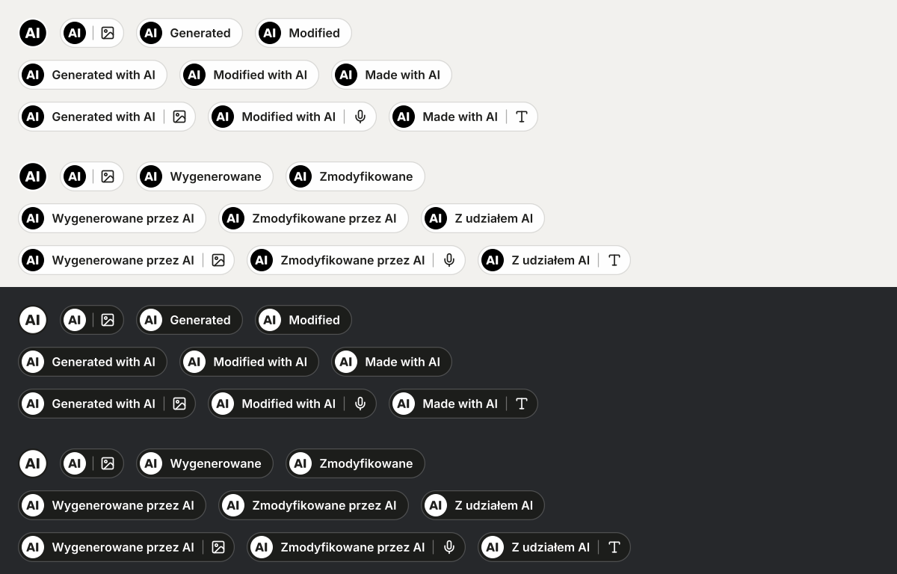
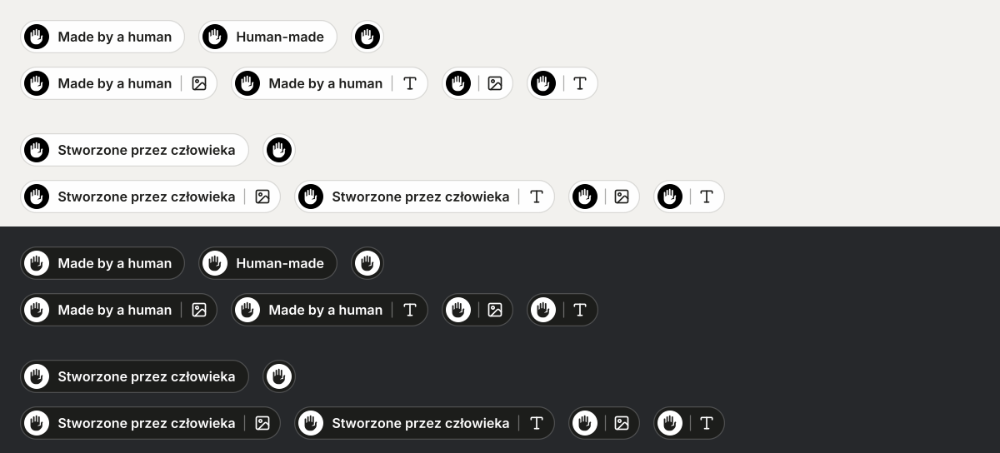

# ai-content-labels

[](https://github.com/JK-G/ai-content-labels/actions/workflows/test.yml)

## TL;DR

ai-content-labels marks AI-generated and human-made content with the official EU icons, from any AI agent. It tells the agent whether the EU AI Act requires a label, burns the label into the image when it does or when nobody can tell, and returns the alt text. It ships as a CLI, an MCP server, a Node library and an Agent Skill for Claude Code, Codex, Gemini CLI, Copilot and Cursor.

Install it in Claude Code:

```
/plugin marketplace add JK-G/ai-content-labels
/plugin install ai-content-labels@ai-content-labels
```

Or run the CLI with no install (Node.js 20.9 or newer):

```
npx -y -p github:JK-G/ai-content-labels ai-labels label image.png --realistic --description "what it shows"
```

Any MCP client starts the server with `npx -y -p github:JK-G/ai-content-labels ai-content-labels-mcp`; client settings are under [MCP server](#mcp-server).

To place labels by hand, download a ready-made pack:

[](https://github.com/JK-G/ai-content-labels/releases/latest/download/ai-generated-labels.zip) [](https://github.com/JK-G/ai-content-labels/releases/latest/download/human-made-labels.zip)


What it does for an agent:

- One call right after it generates an image: `ai-labels label`, or `label_image` over MCP.
- A label only where the AI Act requires one (deep fakes, AI text on a matter of public interest without editorial review) or where nobody can tell, as a precaution.
- Nothing where a label would only be voluntary, unless the user opts in with `--voluntary`.
- The smallest legible label, the EU "AI" icon alone, in the spot where it covers the least, and the alt text for screen readers.
- Labels for web pages as HTML, and ready-made AI and "Made by a human" label packs to place by hand.

Unofficial. Not affiliated with the European Commission, and not legal advice.

## Why

Article 50(4) of the AI Act applies from 2 August 2026. Deep fakes, and AI-generated text published to inform the public on matters of public interest, must be disclosed by the professional user of the AI system (the deployer). The deployer duty was not delayed by the AI Omnibus. On 10 June 2026 the Commission published three icons for this, free for anyone to use. In the Commission's words, "the use of these EU icons is optional, but the labelling requirements under Article 50 AI Act are not."

The icons leave the practical questions open. Does this image need a label at all? Which of the three icons? Where does it go, how big, and what does a screen reader hear? How do you show that only the voice was AI and the script was written by a person? This project answers those questions in code, so a person or an agent gets the same answer every time.

## What it does

- **`label`** is the one-call version for an image an agent has just generated or edited. You say whether people could take it for real (`--realistic`, `--no-realistic`, or `--realistic unsure` when nobody can tell); it runs `decide` and stamps the label `decide` picked when the label is required or the answer is unsure. A voluntary label is not stamped unless you pass `--voluntary`. Over MCP it is `label_image`, which also takes the image as a URL or base64 and can return the labelled image instead of writing a file.
- **`decide`** goes through the Article 50(4) questions: would the audience take the content for real, is it an artistic work, is the text published on a matter of public interest, did a person review it. It returns whether the label is a duty or a voluntary choice, which label fits (and the official EU icon with the same meaning), where to place it, the label sentence and the next step, as a command and, in JSON and over MCP, as the tool call to make. A voluntary AI label gets no next step unless you pass `--voluntary`. When a deciding fact is missing, it asks one question instead of guessing; when nobody knows the answer, `unsure` labels as a precaution. The answer is a few lines; `--explain` adds the legal basis, notes and sources.
- **`stamp`** burns the label into a JPG, PNG, WebP, AVIF or TIFF, so it survives downloads and reshares as the EU guidance asks. You always say which label (`--kind`); stamp never assumes "Generated with AI". By default the label is the EU "AI" icon alone, as small as it can be while still readable on a phone, and it sits where it covers the least, bottom right first; see [Size, place and colour](#size-place-and-colour). For generated and modified labels an IPTC DigitalSourceType tag goes into the XMP; basic and human-made labels get only the project's marker, because the IPTC vocabulary has no term for them.
- **`place`** works out where `stamp` would put the label, how big and in which colour, and writes nothing. It returns the box in px and in % of the image, and the `render` options that draw the same label, so a page or an HTML ad template can draw it as HTML or SVG over the image. Over MCP it is `place_label`.
- **`render`** draws the same label as SVG, PNG or WebP, with `role="img"`, `lang` and an `aria-label`. With `--format html` it writes the label as real text and inline icons, for web pages and apps.
- **Content-type icons** show which part was AI: image, text, audio, voice, music, video. A second label, "Made by a human", shows which part was not.
- **Ready-made label packs** for people who place labels by hand, no agent needed: AI labels on the EU icon, and "Made by a human" labels. SVG and PNG, English and Polish, light and dark. See below.
- **`eu`** gives you the twelve official EU files, unchanged.
- **Languages:** English and Polish wording is built in. For the other 22 official EU languages, pass `--lang` with your own `--text` in that language (`--lang de --text "Mit KI generiert"`), so screen readers read the label with the right voice.

## Ready-made labels

Both packs are plain files you place yourself, drawn by this project's renderer. Download them with the buttons at the top, from the [latest release](https://github.com/JK-G/ai-content-labels/releases/latest), or pick single files from the folders. Every label comes as SVG and as PNG at 48 and 128 px on a transparent background, in English and Polish, light and dark.

### AI labels



[`labels/ai-generated`](labels/ai-generated) has 120 labels on the EU "AI" icon: the icon alone, the icon with one content-type icon, one word ("Generated", "Modified"), the full wording ("Generated with AI", "Modified with AI", "Made with AI"), and the wording with one content-type icon. Use them where the label is required, or where you choose to label; the [pack's README](labels/ai-generated/README.md) says when the AI Act asks for one.

### "Made by a human" labels

An AI agent should not be the one to call your work human-made, so these labels are for you to place.



[`labels/human-made`](labels/human-made) has 58 labels: the label with text, a short "Human-made" in English, the hand alone, and each of these with one content-type icon (image, text, audio, voice, music, video). Use them only where no generative AI was involved; the [pack's README](labels/human-made/README.md) has the rules, placement tips and credits.

## Use it with your agent

Requires Node.js 20.9 or newer. Drawing SVG labels and `decide` need nothing else. Stamping and PNG output use [sharp](https://sharp.pixelplumbing.com), an optional dependency that npm installs with the package.

| Agent or tool | Way in | Setup |
|---|---|---|
| Claude Code | Plugin: skill and MCP server | [Claude Code](#claude-code) |
| Codex, Gemini CLI, GitHub Copilot in VS Code, Cursor | Agent Skill, or the MCP server | [Agent Skill](#agent-skill), [MCP server](#mcp-server) |
| Claude Desktop, Windsurf (Devin Desktop) | MCP server | [MCP server](#mcp-server) |
| OpenAI Agents SDK, Vercel AI SDK, LangChain | MCP server from code | [In code](#in-code) |
| n8n, ChatGPT apps, cloud agents | MCP server in HTTP mode | [HTTP mode](#http-mode) |
| Scripts, CI, ComfyUI | CLI | [CLI](#cli) |
| Your own Node.js code | Library | [Node library](#node-library) |

Our test suite covers the CLI, the library, the stdio MCP server and the HTTP mode on Windows, macOS and Linux. The client setups below follow each client's documentation; we have not run them in every client, so treat the ones marked untested as a starting point.

### Claude Code

Install the plugin with the two `/plugin` commands in the [TL;DR](#tldr). The plugin system does not run npm, so after a plugin install ask Claude to "run ai-content-labels doctor" and it will tell you the one command that adds sharp.

### Agent Skill

The skill folder works in any agent that reads [Agent Skills](https://agentskills.io/specification). Per the vendors' docs, Codex, Gemini CLI, Copilot in VS Code and Cursor read `~/.agents/skills/`, and Claude Code reads `~/.claude/skills/`; check your client's docs if the skill does not show up. For one project only, use `.agents/skills/` inside it.

```
git clone https://github.com/JK-G/ai-content-labels
mkdir -p ~/.agents/skills
cp -r ai-content-labels/skills/ai-content-labels ~/.agents/skills/
cd ~/.agents/skills/ai-content-labels && npm install sharp@0.35
```

On Windows PowerShell, copy with `Copy-Item -Recurse ai-content-labels\skills\ai-content-labels $HOME\.agents\skills\`. The last step adds sharp to the copied skill; skip it if you only need SVG labels and `decide`. The folder carries its own licence notices (`NOTICE.md`), so copy it whole.

### MCP server

Every client starts the same command: `npx -y -p github:JK-G/ai-content-labels ai-content-labels-mcp`. The first start downloads the package and sharp, which can take a minute. On Windows some clients need `"command": "cmd"` with `"/c", "npx"` at the start of the arguments.

Codex (untested), in `~/.codex/config.toml`:

```toml
[mcp_servers.ai-content-labels]
command = "npx"
args = ["-y", "-p", "github:JK-G/ai-content-labels", "ai-content-labels-mcp"]
startup_timeout_sec = 60
```

or `codex mcp add ai-content-labels -- npx -y -p github:JK-G/ai-content-labels ai-content-labels-mcp`.

Gemini CLI (`~/.gemini/settings.json`), Claude Desktop (`claude_desktop_config.json`) and Windsurf (`mcp_config.json`), untested:

```json
{
  "mcpServers": {
    "ai-content-labels": {
      "command": "npx",
      "args": ["-y", "-p", "github:JK-G/ai-content-labels", "ai-content-labels-mcp"]
    }
  }
}
```

Cursor (`.cursor/mcp.json`) takes the same block with `"type": "stdio"` added. VS Code (`.vscode/mcp.json`) names the top key `servers` (untested):

```json
{
  "servers": {
    "ai-content-labels": {
      "type": "stdio",
      "command": "npx",
      "args": ["-y", "-p", "github:JK-G/ai-content-labels", "ai-content-labels-mcp"]
    }
  }
}
```

The tools are `label_image`, `decide_label`, `render_label`, `stamp_image`, `place_label` and `eu_icon`. Each has an output schema and returns structured content next to the same JSON as text, with the `version` that made it. The server speaks MCP 2024-11-05 to 2025-11-25 (clients that start with `initialize`) and 2026-07-28 (`server/discover` and per-request metadata).

### In code

These pass the same command to the framework's MCP client. All untested.

OpenAI Agents SDK (Python):

```python
from agents.mcp import MCPServerStdio

labels = MCPServerStdio(params={"command": "npx", "args": ["-y", "-p", "github:JK-G/ai-content-labels", "ai-content-labels-mcp"]})
```

Vercel AI SDK, with the stdio transport from the MCP TypeScript SDK (`@modelcontextprotocol/sdk`):

```js
import { createMCPClient } from '@ai-sdk/mcp';
import { StdioClientTransport } from '@modelcontextprotocol/sdk/client/stdio.js';

const labels = await createMCPClient({
  transport: new StdioClientTransport({ command: 'npx', args: ['-y', '-p', 'github:JK-G/ai-content-labels', 'ai-content-labels-mcp'] }),
});
```

LangChain (`langchain-mcp-adapters`):

```python
from langchain_mcp_adapters.client import MultiServerMCPClient

client = MultiServerMCPClient({"labels": {"command": "npx", "args": ["-y", "-p", "github:JK-G/ai-content-labels", "ai-content-labels-mcp"], "transport": "stdio"}})
```

The Agents SDK can also reach the server in HTTP mode with `MCPServerStreamableHttp`.

### HTTP mode

For clients that cannot start a local process:

```
npx -y -p github:JK-G/ai-content-labels ai-content-labels-mcp --http
```

It serves Streamable HTTP on `http://127.0.0.1:8787/mcp` with JSON responses. The defaults are the safe ones:

- It listens on 127.0.0.1 only. `--host 0.0.0.0` (or any other address) also needs `--token <secret>` (or `AI_CONTENT_LABELS_TOKEN`), and every request must then send `Authorization: Bearer <secret>`.
- File paths are off. Images come in as an https URL or base64 and go back as image content in the result. `--allow-files` turns paths on when the server runs on your own machine.
- Plain http URLs, and URLs that point at loopback or private addresses, are refused, so the server cannot be used to read your network. (The CLI, the stdio server and the library also fetch http URLs.)
- At most 3 tool calls run at once; more get 503 with `Retry-After`. Images over 50 megapixels, and SVG input, are refused before they are decoded.
- Browser requests need `--allow-origin <origin>`; any other Origin header gets 403.

The built-in n8n MCP Client node speaks HTTP only, so point it at the `/mcp` address with the bearer token. ChatGPT apps and connectors need a public HTTPS address: run HTTP mode behind a TLS proxy with a token. We have not tested either.

### CLI

The `npx` line in the [TL;DR](#tldr) runs the CLI with no install. Installed with npm (`npm install -g github:JK-G/ai-content-labels`), the command is `ai-labels`, also available as `ai-content-labels`. From a clone, run `node skills/ai-content-labels/scripts/ai-labels.mjs`.

### Node library

```js
import { labelImage } from 'ai-content-labels';

const result = await labelImage(imageBuffer, { realistic: true, description: 'What the image shows' });
// result.buffer: the labelled image; result.alt: the alt text to publish; result.required: a legal duty or not
// realistic: 'unsure' labels as a precaution; realistic: false stamps nothing (stamped: false) unless voluntary: true
```

`labelImage` also takes a file path or an http(s) URL. The package exports `decide`, `renderLabel`, `renderHtml`, `stampImage`, `stampBuffer`, `placeLabel` and `officialIcon` as well. Every result has a `version` field.

## After your agent generates an image

Run `ai-labels init --write` once in a project. It adds a short block to `AGENTS.md`, or to the file you name with `--file`, such as `GEMINI.md`. The block tells the agent to run `label` on every image it makes for publication, to answer the realism question honestly (`unsure` when nobody can tell) and to publish the alt text. Images whose label is only voluntary stay unlabelled; `init --write --voluntary` writes a block that labels them too. Running it again updates the block in place.

Where the common image tools put their files, and the step after each:

- **Codex.** Per Codex's imagegen skill, built-in image generation saves to `$CODEX_HOME/generated_images/<session>/`; check the Codex docs for your version. Copy the image into the workspace, then run `ai-labels label <file> --realistic` or `--no-realistic`. Untested.
- **Gemini CLI with the nanobanana extension.** Images land in `./nanobanana-output/`; run `ai-labels label nanobanana-output/<file>` with the realism answer. Untested.
- **OpenAI Agents SDK.** The image generation tool returns base64. Pass it to `label_image` as `input_base64` and take the labelled image from the image content of the result, or save it and run the CLI. Untested.
- **ComfyUI.** Images go to `ComfyUI/output`. Add a step after the queue finishes that runs `ai-labels label` on the new file. Untested.
- **n8n.** Use HTTP mode with the MCP Client node, or an Execute Command node that writes the binary to disk and runs `ai-labels label`. Untested.
- **C2PA.** Stamping changes the pixels, so stamp first and sign after. Run `ai-labels label` with `--out`. Then, in the manifest you sign the labelled file with using `c2patool`, add a `c2pa.created` action whose `digitalSourceType` is `http://cv.iptc.org/newscodes/digitalsourcetype/trainedAlgorithmicMedia` (generated) or `compositeWithTrainedAlgorithmicMedia` (modified). c2patool writes only what your manifest contains. A manifest signed before the stamp no longer verifies. Untested.

## Quick start

Ask your agent in your own words: "label this image as AI-generated", "does this AI photo need a label under the AI Act?", or in Polish "oznacz tę grafikę jako wygenerowaną przez AI". The skill works out the facts, runs `decide`, stamps or renders the label and gives you the alt text to publish.

From the command line. `ai-labels` is the command the package installs; from a clone, run `node skills/ai-content-labels/scripts/ai-labels.mjs` instead.

For an image an agent just made, `label` decides and, when a label is needed, stamps it in one step. A low-poly wolf would not be taken for a photo, so its label is voluntary and nothing is written:

```
$ ai-labels label wolf.png --no-realistic --description "Low-poly grey wolf standing, front view"
NOT REQUIRED: not a deep fake (would not be taken for real)
Not labelled, and no file written: the label is voluntary here, so publish the original. To label it anyway, rerun with --voluntary.
alt: Low-poly grey wolf standing, front view.
```

With `--voluntary` the same call stamps it:

```
$ ai-labels label wolf.png --no-realistic --voluntary --description "Low-poly grey wolf standing, front view"
NOT REQUIRED: not a deep fake (would not be taken for real) (labelled because --voluntary is set)
wolf.ai-label.png
label: 58×58 px, icon, white disc, bottom-right (auto: bottom-right is free), mark contrast 16.88:1, stands out 16.01:1 from the image
display: 18 px tall when the image is shown 390 px wide (full width on a phone; --display-width for other sizes)
disclosure: Generated with AI: image.
alt: Low-poly grey wolf standing, front view. Generated with AI: image.
metadata: XMP DigitalSourceType trainedAlgorithmicMedia
```

`--realistic` stamps the same label because it is required, and `--realistic unsure` stamps it as a precaution (the first line then starts with `UNSURE, LABEL AS A PRECAUTION`). The label is the EU "AI" icon alone, with the words in the alt text. `--short` adds the word "Generated" next to the icon, and `--modified` is for a real photo that AI changed. Without a realism answer `label` asks the question below and exits with code 2.

For anything else, start with `decide`:

```
$ ai-labels decide --media image --origin generated
UNKNOWN: Would the people who will see it take it for a genuine photo, recording or event? Rerun with --realistic or --no-realistic; if nobody can tell, with --realistic unsure, and the label is added as a precaution.

$ ai-labels decide --media image --origin generated --realistic
REQUIRED: realistic AI image, a deep fake under Article 50(4)
Next: ai-labels stamp <image> --kind generated --media image --description "what it shows"
Label: --kind generated --media image, says "Generated with AI: image." (official EU icon with this meaning: generated)
- Burn the label into the image pixels (the `stamp` command), so it stays visible when the image is downloaded or reshared.
- stamp puts the label in the least invasive spot, with nothing covering it: the bottom-right corner when it is free, ...
Accessibility: Give the image an alt text that says what it shows, then the label sentence (alt="<what the image shows>. Generated with AI: image."); ...
Do not animate the label (WCAG 2.2.2) or make it flash (WCAG 2.3.1). Not legal advice. More: rerun with --explain

$ ai-labels stamp wolf.png --kind generated --media image --short --description "Low-poly grey wolf standing, front view"
wolf.ai-label.png
label: 325×58 px, short, light pill, bottom-right (auto: bottom-right is free), text contrast 14.78:1, stands out 14.21:1 from the image
display: 18 px tall when the image is shown 390 px wide (full width on a phone; --display-width for other sizes)
disclosure: Generated with AI: image.
alt: Low-poly grey wolf standing, front view. Generated with AI: image.
metadata: XMP DigitalSourceType trainedAlgorithmicMedia

$ ai-labels render --kind modified --media image,voice --human text --lang pl --out label.svg
$ ai-labels render --format html --kind generated --media text
```

`decide` exits with code 2 when it has to ask, so a script cannot mistake a question for a verdict. For text published on a matter of public interest it also asks whether a person reviewed it (`--editorial-review`), because that decides the case. With `--json`, the field `missing` names the argument to answer, and `next` holds the next call: the MCP tool, the arguments to pass unchanged, the ones still to fill in (`fill`) and the CLI line. While decide still asks, `next` is the same decide call with the answer `unsure`, for when nobody can answer. For a voluntary AI label `next` is null and `optIn` says how to label anyway. `ai-labels help` lists every option.

## Which label

| Kind | Use it when | Text (en / pl), default | With `--full` |
|---|---|---|---|
| `generated` | All of the content comes from AI, apart from the prompt | Generated / Wygenerowane | Generated with AI / Wygenerowane przez AI |
| `modified` | Real or human-made content was partly changed by AI: a swapped face, added objects, a replaced voice | Modified / Zmodyfikowane | Modified with AI / Zmodyfikowane przez AI |
| `basic` | AI was involved and you want your own words, such as "Voice generated with AI" | Made with AI / Z udziałem AI | the same |
| `human` | A person made it without generative AI, and you want to say so | Human-made / Stworzone przez człowieka | Made by a human / Stworzone przez człowieka |

**Forms.** `stamp`, `label` and `place` use the icon form for AI labels: the EU "AI" disc alone, which is what Measure 1.1(a) of the Code of Practice asks for. A word such as "Generated" is only encouraged (1.1(b)), so it comes on request: `--short` for one word, `--full` for the whole phrase, `--minimal` for the disc with the content-type icons. Human-made labels keep their word, and so does a label in your colour (`--color`, `--palette`), which needs a pill. `render` keeps its default, the short form, so existing calls draw the same SVG.

**Ads and feeds.** The label sentence in a caption only counts if people see it at first exposure (Code of Practice Sub-measure 1.2.1). In a feed the end of an ad text often sits behind a "See more" fold, and some ad formats have a short text field, so the sentence may not be seen. Put the word on the image (`--short`) unless the label sentence is in the first visible line of the caption.

The human-made mark is this project's own, not an EU icon. Next to the "AI" disc, the default word reads like the EU icons themselves ("AI Generated", "AI Modified"). `--media` adds the content-type icons. `--human text` puts a "Made by a human" label next to an AI label. `--uppercase` sets the text in spaced capitals like the icons.

### Minimal form


`--minimal` drops the text but keeps the pill. The left side says who made it (the EU "AI" disc, or a hand in the same disc), the right side says what (the content-type icons). `--icon` goes further: the EU disc alone, with a thin ring, the default for AI labels in `stamp`, `label` and `place`. Two things to know before you drop the words:

- In user testing for the EU icons, labels with text were noticed and understood better. Add the word (`--short`) when the user wants it, and say the label sentence in the caption when the label is a legal duty.
- Without text, "generated" and "modified" look the same. Only the alt text tells them apart.

The icon and labels with text go down to 18 px, the minimal form to 20 px; see [Size, place and colour](#size-place-and-colour) for why. The hand is a filled raised hand with five fingers, 0.62 of its disc tall at every size, in SVG, PNG and HTML alike. Being solid, it matches the weight of the bold "AI" letters, and at the smallest sizes it still reads as a hand by its outline.


## Size, place and colour

Unless you or your agent choose otherwise, a stamped label takes the smallest form and size that still do the job, in the spot where it covers the least.

- **Form.** The EU "AI" icon alone for an AI label, whether it is required, added as a precaution or voluntary (with `--voluntary`), with the words in the alt text. The Code of Practice on Transparency of AI-Generated Content asks for an icon whose main element is the letters "AI" (Measure 1.1(a)); text such as "generated" is encouraged, not required (1.1(b)). `--short` adds the word, `--full` the phrase. Human-made labels keep their words, because a hand alone is not a sign people know yet.
- **Size.** 18 px tall for the icon and for a label with a word, 20 px for the minimal pill, as the image is shown full width on a phone (390 CSS px). A 1080 px wide image gets a 50 px label, or 56 px minimal. Larger screens show it larger. For an image never shown that small, pass the width it is shown at: `--display-width 1080` gives the same image an 18 px label.
- **Why 18 px.** The Code lets the icon "appear in different sizes depending on the context" as long as it is "readable and recognisable to natural persons" (Measure 1.1(c)) and sets no minimum; the Commission's icon page asks for a "clearly visible size". So the floor comes from legibility. The EU minimum eyesight for driving is a visual acuity of 0.5 (Commission Directive 2009/113/EC, Annex III), which recognises a letter 10 minutes of arc tall. People hold a phone about 32 cm away when reading a web page ([Bababekova et al. 2011](https://pubmed.ncbi.nlm.nih.gov/21499163/)), where one CSS px is about 0.166 mm, so a letter needs 5.65 CSS px. The "AI" in the EU disc is 0.386 of the disc, so the disc is 16 px, 18 px with its ring. A word needs an x-height of 5.65 px, which Inter reaches at 10.5 px type; an 18 px pill holds it with a 1 px inset. Stamped labels are laid out at the size they are seen, so the type is 10.5 px or more on the phone, not just in the file.
- **Place.** The bottom-right corner when it is free. If text, a logo or detail sits there, the freer of bottom centre and bottom left; if the whole bottom edge is taken, the top edge. The tool scores how busy each spot is (the mean brightness gradient under and around the label) and reports the scores with the spot it chose. `--position` picks a spot yourself.
- **Part of an image.** When only part of a graphic is AI, such as a generated photo inside a designed ad, pass that part's box: `--region 200,390,860,690` in px, or in % of the image. The label goes on that part, in its least invasive spot. For a rounded or angled part, pass its shape instead: `--region-path "M300 200 H780 V800 L540 1000 L300 800 Z"` (SVG path data in image px, here a shield) or `--region-mask mask.png` (inside where the mask's alpha, or its brightness when it has no transparency, is 50% or more). The label and its margin then lie fully inside the shape: each spot starts at its corner of the shape's bounding box and moves inward until it fits.
- **What to keep clear.** The busy score sees texture, not meaning: a smooth back, a face in soft light or a clean product surface can score as free. Pass `--avoid x,y,w,h` (px or %, repeat it for more boxes) for faces, people, the product and text, and the label keeps clear of them. Every spot it did not take is listed in `label.why` with the reason, such as `overlaps avoid box 1` or `busy (score 9.1, free is 6 or less)`. When no spot is left, `stamp` stops and says why instead of covering something.
- **Platform safe zones.** `--safe-zone` keeps the label out of the edges a platform covers with its buttons and captions. `meta-reels` leaves 14% at the top, 35% at the bottom and 6% on each side, from the [Meta Ads Guide for Instagram Reels](https://www.facebook.com/business/ads-guide/update/video/instagram-reels) ("Consider leaving at least 14% of the top, 35% of the bottom, and 6% on each side of your asset free from text"; checked 18 October 2026). For other platforms take the insets from the platform's own template and pass them as `--safe-zone top,right,bottom,left` in px or %, for example `--safe-zone 14%,6%,35%,6%`.
- **Colour.** A white or dark pill by default, whichever stands out more from the spot. `--color #1f7a52` uses your colour, and `--palette #1f7a52,#f2c94c` takes the brand colour that stands out most from the spot. The pill is then opaque and the text turns white or dark to keep 4.5:1 contrast; when no palette colour stands out from the spot, the neutral pill is used and `colorNote` says so. `--color auto` reads the colours of the image and takes its accent colour, toned darker or lighter until the text reaches 4.5:1, so a brand green may come out a shade deeper. With a region, `auto` reads only the part outside it (the designed part of a composite) when that part is at least 20% of the image, so a red cable or the sky in the AI photo does not set the label colour; `label.color.sampled` says which part it read. When you know the brand colour, pass it with `--color` or `--palette` instead of `auto`. The disc stays the official black or white EU icon.
- **HTML pages.** When the page draws the label itself, run `place` (MCP `place_label`) with the same options instead of `stamp`. Pin the label over the image by the sides `boxPercent.anchor` names (`right` and `bottom` for a bottom-right label), so it stays in its corner whatever its drawn width, and draw it with `render` and `renderArgs`. As SVG, draw it with `renderArgs` and let it scale with the image. As HTML (`--format html`), the height is in CSS px: pass `--height` with `label.cssHeight`, the label's height where the image is shown, and the pill is exactly that tall (at least 18 px, 20 px minimal).

## Upgrading

0.6 stops labelling where the label is only voluntary. `label` and `label_image` stamp only when the label is required or the realism answer is `unsure`; for `--no-realistic` they write nothing and return `stamped: false`. `decide` returns `next: null` for a voluntary AI label. To keep the 0.5 behaviour, pass `--voluntary` (MCP `voluntary: true`). `--only-if-required` (`only_if_required`) is still accepted and does nothing. Required and precautionary labels look exactly as in 0.5.

0.5 changed the stamped label again: `stamp`, `label` and `place` now give an AI label the EU icon alone, and the smallest size is 18 px as shown on a phone (50 px on a 1080 px wide image) instead of 24 px (67 px). Labels with words are laid out at the size they are seen, with a thinner inset under 24 px, so their pixels change too. `render` keeps its defaults: the same call draws the same SVG.

- **The 0.4 look at the new size:** `--short`. One word next to the disc, 18 px as shown.
- **The 0.4 size:** `--short --height <n>` with the 0.4 rule `n = min(512, max(24, ceil(24 × image width / 390)))` (67 for a 1080 px wide image). Add `--display-width <image width>` for the 0.4 stamp pixel for pixel.
- **The 0.1 to 0.3 stamp, pixel for pixel:**

```
ai-labels stamp image.png --kind generated --media image --full --position top-left --height <n> --display-width <image width>
```

where `n = min(512, max(28, round(0.06 × shorter side), round(0.025 × longer side)))`: 65 for 1080×1080, 1080×1350 and 1080×1920, 72 for 1200×1200. `--display-width` with the image's own width lays the label out at its file size, as 0.1 to 0.3 did. In 0.3 a display width also raised the height to at least `ceil(28 × image width / display width)`; work that into `n` yourself. Over MCP pass `full: true`, `position: "top-left"`, `height` and `display_width`.

0.4 had changed three defaults of 0.1 to 0.3: one word ("Generated") instead of the full wording, the smallest legible size instead of about 6% of the shorter side, and auto placement, bottom right first, instead of the top-left corner. A minimal label from `render` (`--minimal`) is the same SVG from 0.1.0 to 0.6.0, so tests that hash it keep passing. Since 0.5 every JSON result carries `version`, so a pipeline can check which version made it.

## Accessibility

Article 50(5) asks for disclosures that conform to the applicable accessibility requirements, and the EU icon guidance asks for alt text or ARIA labels. The labels follow WCAG 2.2:

- **Contrast:** the text keeps at least 4.5:1 against its own background even when that background is semi-transparent and the image behind it is pure black or pure white. A label in your own colour (`--color`) is opaque, and its text is white or dark, whichever keeps 4.5:1. Options that would break this are refused unless you pass `--allow-low-contrast`.
- **Screen readers:** `render`, `stamp` and `alt` return the label sentence as `disclosure` ("Generated with AI: image and voice."). Text burned into pixels is invisible to assistive technology, so the alt text of a labelled image is a short description of what it shows, then that sentence: pass `--description` and the commands return it composed as `alt` ("Modern house among pine trees, architectural visualisation. Generated with AI: image."). Without a description `alt` is null, so an agent cannot publish the sentence alone as the alt of an informative image. `render` also returns `labelAlt`, the alt for an `` that shows the label on its own. When the label is a legal duty, put the sentence in a visible caption too. Rendered SVGs carry it in `aria-label` and `<title>`; when the image's alt or caption already says it, give a separate label `alt=""` or `aria-hidden="true"`.
- **Real text on web pages:** `render --format html` writes the label as text with decorative inline icons and a stylesheet (`--css`). By default the type follows the page and never drops below 12 px; `--height 18` sets the pill to exactly 18 px, with a thinner inset and the words at 10.5 px, as in the SVG label at that height. `--icon` gives the disc alone as inline SVG, with the label sentence for screen readers. It zooms, reflows, translates and follows the page's colour scheme and forced colours, which an image of text cannot do (WCAG 1.4.4, 1.4.5, 1.4.12). A page that declares only a light scheme keeps a light label when the system is dark; `--theme` pins one. In a narrow column the icons move under the words instead of the words breaking. Use SVG or PNG for images, video overlays and places that only accept an image.
- **Legible everywhere:** in SVG, PNG and stamped labels the text is drawn as outlines from Inter SemiBold, so it looks the same in every browser and image viewer and covers the alphabets of all 24 official EU languages. The icon and labels with text are never smaller than 18 px tall in the file, and minimal ones 20 px; an image too small for that gets an error instead of an unreadable label. By default they are that size on a phone that shows the image full width too, with the type at 10.5 px or more there. When a wide banner or a small region forces the label to shrink, `stamp` says so in a `warning`, and `displayHeight` always reports how tall the label looks. `--display-width` sizes it for another screen.
- **Still:** labels are static. The skill tells agents not to animate them (WCAG 2.2.2) or make them flash (WCAG 2.3.1).

## What the AI Act asks

The short version is in the [Why](#why) section. The rules behind `decide`, with quotes and links to the Act, the EU icon page and the Code of Practice, are in [`references/rules.md`](skills/ai-content-labels/references/rules.md). They include the Commission's Guidelines on Article 50 of 20 July 2026, with paragraph numbers. `decide` is a checklist, not legal advice.

## Limits

- **Video and audio are not stamped yet.** For video, render a PNG label and overlay it for the whole clip with ffmpeg (the skill shows the command). Labels that follow the timeline, such as a voice icon shown only while an AI voice speaks, are planned. Audio-only content needs a spoken disclaimer; `decide` says so.
- **One still image per `stamp` run.** Batch mode is planned. Animated WebP and GIF are refused; export a still frame.
- **Stamping rewrites the file.** The EXIF data, the colour profile and the XMP (rights, credit, captions) are carried over. The project's marker is always added to the XMP, so a labelled file is not stamped twice by mistake, even after a rename; `--no-metadata` skips only the IPTC DigitalSourceType. An older IPTC-IIM block is not carried over. The pixels change, so an existing C2PA manifest no longer verifies: sign again after stamping if you rely on C2PA.
- **Two built-in languages.** English and Polish. The other EU languages need `--lang` and `--text` (and `--human-text` for a human-made part); the sentence is then your text alone, and the content-type icons stay decorative. Built-in wording for more languages is welcome as a pull request to [`i18n.mjs`](skills/ai-content-labels/scripts/lib/i18n.mjs).

## Roadmap

1. A simple online generator: pick the options, download PNG or SVG.
2. Video labels that follow the timeline.
3. More built-in languages.

## Credits and licences

- **EU icons:** European Commission, [EU icons for labelling AI-generated content](https://digital-strategy.ec.europa.eu/en/policies/eu-icons-labelling-ai-generated-content). Free to use without attribution. Using them does not mean you signed the Code of Practice. The human-made mark (a hand in the same disc) is this project's own design, not an EU icon.
- **Content-type icons:** [Lucide](https://lucide.dev), ISC licence; the music and text icons are derived from Feather, MIT licence.
- **The hand in the human-made mark:** [Heroicons](https://heroicons.com) "hand-raised" (solid) by Tailwind Labs, MIT licence. The full notices for both sets ship in the skill folder (`assets/icons/LICENSE.txt`).
- **Font:** [Inter](https://rsms.me/inter/) by Rasmus Andersson, SIL Open Font License 1.1.

The code is MIT. Details for the third-party files are in [NOTICE.md](NOTICE.md).
